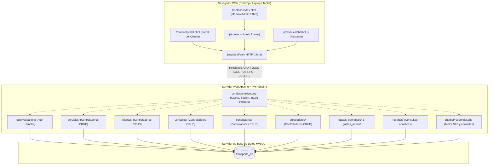
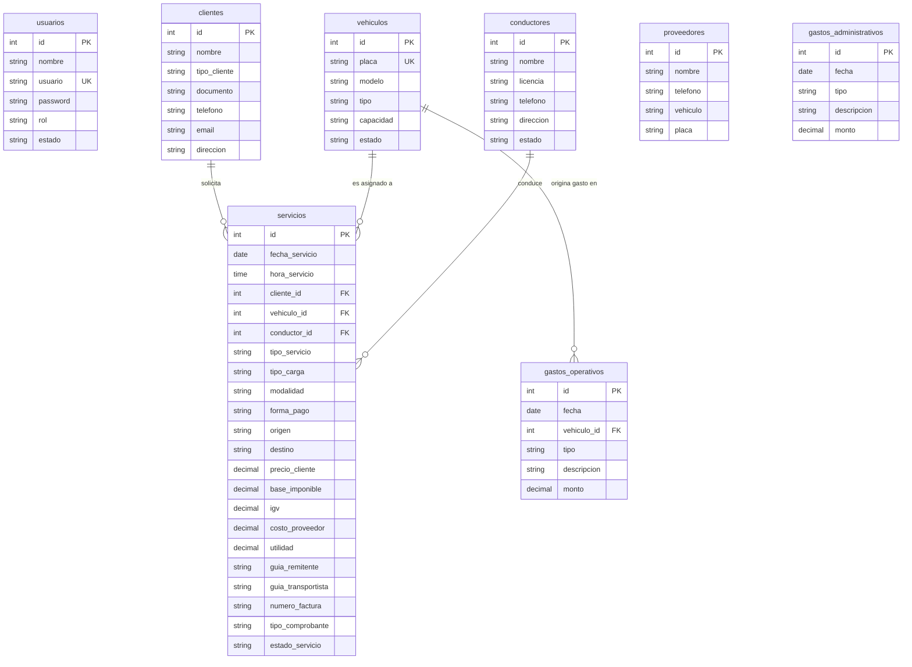
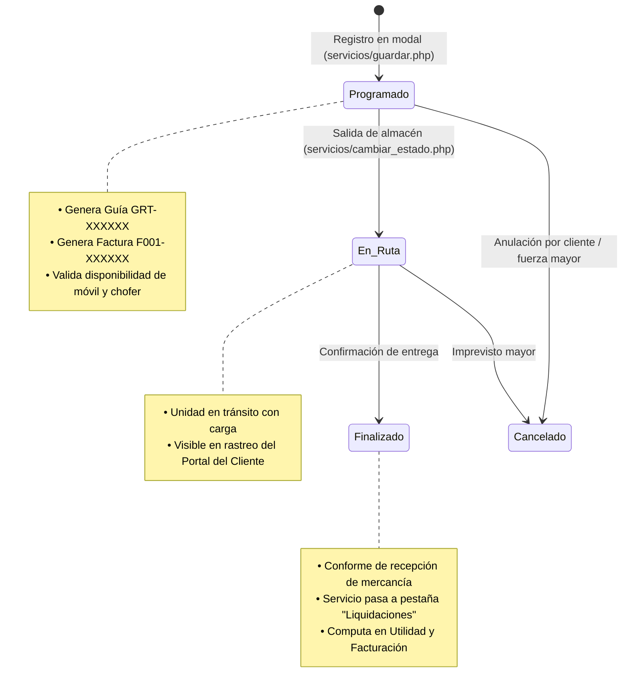

# 🚚 MANUAL INTEGRAL Y DOCUMENTACIÓN TÉCNICA DEL SISTEMA
# VADEXSA LOGISTIC — TMS & ERP ENTERPRISE

**Organización:** VADEXSA LOGISTIC S.A.C.  
**RUC:** 20604629293  
**Sistema:** Sistema Web Integrado de Gestión de Transporte, Carga, Flota, Liquidaciones y Portal del Cliente  
**Versión del Sistema:** 2.1 (Arquitectura SPA + Backend Híbrido RESTful + Sub-reportes y Portal del Cliente v1.3)  
**Fecha de Publicación:** Octubre 2026  
**Rama del Repositorio:** `noemy`

---

## 📑 ÍNDICE GENERAL

1. [Visión General del Negocio y Alcance del Sistema](#1-visión-general-del-negocio-y-alcance-del-sistema)
2. [Arquitectura Tecnológica e Infraestructura](#2-arquitectura-tecnológica-e-infraestructura)
   - 2.1 Pila de Tecnologías (Stack)
   - 2.2 Diagrama Arquitectural Global
   - 2.3 Patrón SPA Modular (Frontend)
   - 2.4 Patrón de Controladores y Servicios Híbridos (Backend)
   - 2.5 Navegación Adaptable y Soporte Móvil
3. [Diccionario y Modelo de Base de Datos (`transporte_db`)](#3-diccionario-y-modelo-de-base-de-datos-transporte_db)
   - 3.1 Diagrama Entidad-Relación (ER)
   - 3.2 Tabla `usuarios`
   - 3.3 Tabla `clientes`
   - 3.4 Tabla `vehiculos`
   - 3.5 Tabla `conductores`
   - 3.6 Tabla `proveedores`
   - 3.7 Tabla `servicios` (Núcleo Operativo y Financiero)
   - 3.8 Tabla `gastos_operativos`
   - 3.9 Tabla `gastos_administrativos`
4. [Flujos Operativos y Reglas de Negocio Clave](#4-flujos-operativos-y-reglas-de-negocio-clave)
   - 4.1 Ciclo de Vida del Servicio de Transporte
   - 4.2 Control Antidoble Asignación (Flota y Conductores)
   - 4.3 Modalidad Operativa: Propio vs. Tercerizado
   - 4.4 Cálculo Fiscal: Base Imponible, 18% IGV y Utilidad Bruta
   - 4.5 Generación Automática de Correlativos (Guías y Facturas)
   - 4.6 Trazabilidad Histórica por Cliente
5. [Módulos Funcionales del Sistema Administrativo](#5-módulos-funcionales-del-sistema-administrativo)
   - 5.1 Autenticación y Control de Acceso
   - 5.2 Dashboard y Monitor de KPIs Financieros
   - 5.3 Módulo de Servicios y Liquidaciones (Modal en 6 Secciones)
   - 5.4 Programación Diaria y Despacho Operativo
   - 5.5 Catálogos Maestros: Clientes, Vehículos, Conductores, Proveedores
   - 5.6 Módulo de Gastos Operativos y Administrativos
   - 5.7 Centro de Reportes e Inteligencia Financiera
6. [Módulos Innovadores y Nuevas Mejoras (Versión 2.0 y 2.1)](#6-módulos-innovadores-y-nuevas-mejoras-versión-20-y-21)
   - 6.1 Portal del Cliente Autónomo (`portal.html`) y Sub-Vistas Especializadas
   - 6.2 Asistente Virtual / Chatbot Inteligente en Tiempo Real
   - 6.3 Interfaz Empresarial TMS (Tema Oscuro, Widget Tipo de Cambio)
   - 6.4 Motor de Notificaciones Toast y Exportación Universal a Excel
   - 6.5 Entorno de Diagnóstico de Formulario y Solución de Caché (`test_form.html`)
   - 6.6 Suite de Ejecución Rápida y Acceso Directo Windows
7. [Referencia de la API Interna (Endpoints)](#7-referencia-de-la-api-interna-endpoints)
8. [Guía de Instalación, Configuración y Despliegue](#8-guía-de-instalación-configuración-y-despliegue)
   - 8.1 Requisitos del Entorno (WAMP / XAMPP)
   - 8.2 Configuración de Base de Datos y Credenciales
   - 8.3 Métodos de Ejecución y Enlaces de Acceso
9. [Seguridad, Mantenimiento y Buenas Prácticas Recomendadas](#9-seguridad-mantenimiento-y-buenas-prácticas-recomendadas)
10. [Historial de Versiones y Registro de Cambios (Changelog)](#10-historial-de-versiones-y-registro-de-cambios-changelog)

---

## 🏢 1. VISIÓN GENERAL DEL NEGOCIO Y ALCANCE DEL SISTEMA

**VADEXSA LOGISTIC S.A.C.** es una empresa peruana especializada en transporte terrestre de carga pesada, distribución local y nacional, mudanzas empresariales y logística tercerizada.

El sistema fue concebido para resolver las siguientes necesidades críticas de la operación:
1. **Control Unificado de Servicios:** Reemplazar registros manuales o dispersos por un software centralizado con trazabilidad completa desde la cotización y programación hasta la entrega y liquidación.
2. **Administración de Flota y Conductores:** Prevenir cruces de horario, duplicidad de unidades y controlar la vigencia operativa de los vehículos y licencias.
3. **Cálculo Financiero y Fiscal Automatizado:** Automatizar el cálculo de Base Imponible, el 18% de IGV (SUNAT), costos de flete tercerizado y la utilidad neta de cada servicio.
4. **Separación de Gastos:** Clasificar egresos operativos (asociados a unidades de transporte: combustible, peajes, mantenimiento) de los administrativos (alquileres, sueldos de oficina, servicios públicos).
5. **Autoservicio para Clientes:** Proveer a los clientes corporativos un portal web donde consultar el estado de sus pedidos en tiempo real, visualizar guías y revisar su historial.
6. **Asistencia Virtual Operativa:** Chatbot interactivo conectado a la base de datos para responder consultas de personal administrativo y de operaciones en segundos.

---

## ⚙️ 2. ARQUITECTURA TECNOLÓGICA E INFRAESTRUCTURA

### 2.1 Pila de Tecnologías (Stack)

| Capa | Tecnología / Estándar | Propósito y Justificación |
|---|---|---|
| **Frontend Arquitectura** | **Single Page Application (SPA)** | Cero recargas de página, transiciones inmediatas basadas en Hash Routing (`#servicios`, `#dashboard`). |
| **Frontend Lenguaje** | **JavaScript Vanilla (ES Modules 6)** | Cero dependencias de empaquetadores complejos (`node_modules`), alta velocidad de renderizado e independencia nativa en navegadores modernos. |
| **Frontend Estilos** | **CSS3 Nativo Empresarial (`app.css`)** | Más de 1,000 líneas de reglas estructuradas con variables CSS (Dark Theme TMS, estados de badges, layout CSS Grid y Flexbox). |
| **Iconografía** | **Bootstrap Icons (v1.11.3)** | Iconografía vectorial CDN estándar para señalética logística. |
| **Backend** | **PHP 7.4 / 8.x** | Ejecución rápida por scripts sin sobrecarga de frameworks, altamente compatible con servidores Apache en Windows/Linux. |
| **Base de Datos** | **MySQL 5.7 / 8.0 o MariaDB** | Almacenamiento relacional transaccional, con soporte para codificación multilingüe `utf8mb4`. |
| **Conectividad PHP** | **Extensión `mysqli`** | Consultas parametrizadas, transacciones y control de conexiones persistentes. |
| **Autenticación** | **PHP Native Sessions (`PHPSESSID`)** | Almacenamiento de identidad en sesión de servidor, validado mediante `credentials: 'same-origin'` en el cliente `fetch`. |
| **Entorno de Ejecución** | **WampServer / XAMPP / LAMP** | Servidor Web Apache configurado por defecto en `localhost` con el módulo `mod_rewrite` opcional. |

---

### 2.2 Diagrama Arquitectural Global



---

### 2.3 Patrón SPA Modular (Frontend)
El frontend se organiza bajo un esquema de módulos independientes en la carpeta [frontend/js/modules/](file:///c:/wamp64/www/TransporteVadexa/frontend/js/modules/):

1. **`router.js`:** Monitorea el evento `window.addEventListener('hashchange', handleRoute)`. Al cambiar el hash, verifica con `auth.checkSession()` si el usuario está autenticado. Si no hay sesión y la ruta no es `#login`, redirige al inicio de sesión. Si hay sesión, monta el módulo correspondiente en el contenedor `#tms-content-container`.
2. **`api.js`:** Expone el objeto singleton `api` con métodos auxiliares `get()`, `post()`, `put()`, `delete()` que envían automáticamente cabeceras `Accept: application/json`, serializan datos JSON y manejan errores HTTP estándar.
3. **Módulos Vistas (`servicios.js`, `dashboard.js`, etc.):** Cada archivo exporta una función principal `renderNombre(container)` que inyecta la plantilla HTML y asigna los event listeners a formularios, tablas y botones.

---

### 2.4 Patrón de Controladores y Servicios Híbridos (Backend)
Cada directorio del backend (como `servicios/`, `clientes/`, `gastos_operativos/`) opera bajo un modelo híbrido:
* Si la cabecera `Accept` incluye `application/json` o el parámetro `?json=1` o `action=list` está presente, el script omite la inclusión de plantillas HTML y responde inmediatamente con `json_response($data)`.
* Si un usuario accede por navegador directamente sin JavaScript activado, el script puede incluir `header.php` y `sidebar.php` garantizando compatibilidad con la versión original.

En [config/conexion.php](file:///c:/wamp64/www/TransporteVadexa/config/conexion.php) se implementaron funciones globales:
```php
function json_response($data, $status = 200) {
    if (!headers_sent()) {
        header("Content-Type: application/json; charset=UTF-8");
        http_response_code($status);
    }
    echo json_encode($data, JSON_UNESCAPED_UNICODE | JSON_PRETTY_PRINT);
    exit;
}

function get_request_data() {
    $raw = file_get_contents("php://input");
    $json = json_decode($raw, true);
    if (is_array($json)) return $json;
    if ($_SERVER['REQUEST_METHOD'] === 'GET') return $_GET;
    return $_POST;
}

function require_auth() {
    if (!isset($_SESSION['usuario'])) {
        json_response([
            "success" => false,
            "error" => "No autorizado. Inicie sesión.",
            "auth_required" => true
        ], 401);
    }
}
```

---

### 2.5 Navegación Adaptable y Soporte Móvil
En [frontend/js/router.js](file:///c:/wamp64/www/TransporteVadexa/frontend/js/router.js) y [frontend/css/app.css](file:///c:/wamp64/www/TransporteVadexa/frontend/css/app.css) se integró soporte nativo para dispositivos móviles y pantallas táctiles:
* Botón de menú hamburguesa `#sidebar-toggle-btn` que alterna la clase `.mobile-open` sobre la barra lateral.
* Control de acordeón para submenús desplegables mediante la clase `.nav-has-submenu` y `.nav-submenu.open`.
* Vistas responsive en tablas y modales que previenen desbordes en resoluciones menores a 768px.

---

## 🗄️ 3. DICCIONARIO Y MODELO DE BASE DE DATOS (`transporte_db`)

### 3.1 Diagrama Entidad-Relación (ER)



---

### 3.2 Tabla `usuarios`
Almacena las cuentas de acceso administrativo y operativo al sistema.

| Campo | Tipo SQL | Nulo | Clave | Descripción |
|---|---|---|---|---|
| `id` | `INT(11)` | No | PK (AI) | Identificador único del usuario. |
| `nombre` | `VARCHAR(100)` | No | | Nombre completo del colaborador. |
| `usuario` | `VARCHAR(50)` | No | UK | Nombre de usuario para el login (ej: `admin`). |
| `password` | `VARCHAR(255)` | No | | Contraseña encriptada en hash MD5. |
| `rol` | `VARCHAR(30)` | No | | Rol de permisos: `admin`, `operaciones`, `soporte`. |
| `estado` | `VARCHAR(20)` | No | | Estado de la cuenta: `activo`, `inactivo`. |

---

### 3.3 Tabla `clientes`
Directorio de empresas y personas que contratan los servicios de transporte.

| Campo | Tipo SQL | Nulo | Clave | Descripción |
|---|---|---|---|---|
| `id` | `INT(11)` | No | PK (AI) | Identificador único del cliente. |
| `nombre` | `VARCHAR(150)` | No | | Razón social o nombres y apellidos. |
| `tipo_cliente` | `VARCHAR(20)` | No | | Clasificación: `Empresa` o `Persona`. |
| `documento` | `VARCHAR(20)` | Sí | | RUC (11 dígitos) o DNI (8 dígitos). |
| `telefono` | `VARCHAR(50)` | Sí | | Teléfono o celular de contacto. |
| `email` | `VARCHAR(100)` | Sí | | Correo electrónico de facturación o contacto. |
| `direccion` | `VARCHAR(255)` | Sí | | Dirección fiscal o almacén principal. |

---

### 3.4 Tabla `vehiculos`
Flota vehicular de la empresa (unidades propias o permanentes).

| Campo | Tipo SQL | Nulo | Clave | Descripción |
|---|---|---|---|---|
| `id` | `INT(11)` | No | PK (AI) | Identificador único de la unidad. |
| `placa` | `VARCHAR(10)` | No | UK | Placa de rodaje única (mínimo 6 caracteres). |
| `modelo` | `VARCHAR(50)` | Sí | | Marca y modelo (ej: *Volvo FH16, Mercedes Actros*). |
| `tipo` | `VARCHAR(50)` | Sí | | Carrocería (Furgón, Plataforma, Furgón Refrigerado, Cisterna). |
| `capacidad` | `VARCHAR(50)` | Sí | | Capacidad de carga (ej: *24 Ton, 40 m3*). |
| `estado` | `VARCHAR(20)` | No | | Condición operativa: `activo`, `mantenimiento`, `baja`. |

---

### 3.5 Tabla `conductores`
Plantilla de choferes profesionales asignados al transporte.

| Campo | Tipo SQL | Nulo | Clave | Descripción |
|---|---|---|---|---|
| `id` | `INT(11)` | No | PK (AI) | Identificador único del conductor. |
| `nombre` | `VARCHAR(100)` | No | | Nombres y apellidos completos. |
| `licencia` | `VARCHAR(30)` | No | | Brevete profesional (ej: `Q12345678 - A-IIIc`). |
| `telefono` | `VARCHAR(50)` | Sí | | Celular para comunicación de ruta. |
| `direccion` | `VARCHAR(255)` | Sí | | Domicilio del chofer. |
| `estado` | `VARCHAR(20)` | No | | Estado laboral: `activo`, `descanso`, `inactivo`. |

---

### 3.6 Tabla `proveedores`
Empresas de transporte terceras a quienes se subcontrata cuando la flota propia está al 100%.

| Campo | Tipo SQL | Nulo | Clave | Descripción |
|---|---|---|---|---|
| `id` | `INT(11)` | No | PK (AI) | Identificador único del proveedor. |
| `nombre` | `VARCHAR(150)` | No | | Razón social de la empresa de transporte tercerizada. |
| `telefono` | `VARCHAR(50)` | Sí | | Teléfono de despacho o coordinación. |
| `vehiculo` | `VARCHAR(50)` | Sí | | Tipo de vehículo o tracto provisto. |
| `placa` | `VARCHAR(20)` | Sí | | Placa del vehículo subcontratado. |

---

### 3.7 Tabla `servicios` (Núcleo Operativo y Financiero)
Tabla central que almacena todas las operaciones de flete, despacho, facturación y liquidación.

| Campo | Tipo SQL | Nulo | Clave | Descripción y Reglas de Negocio |
|---|---|---|---|---|
| `id` | `INT(11)` | No | PK (AI) | Correlativo del servicio. |
| `fecha_servicio` | `DATE` | No | | Fecha programada para el viaje. |
| `hora_servicio` | `TIME` | No | | Hora límite o estimada de salida. |
| `cliente_id` | `INT(11)` | No | FK | Vínculo a `clientes.id`. |
| `vehiculo_id` | `INT(11)` | No | FK | Vínculo a `vehiculos.id`. |
| `conductor_id` | `INT(11)` | No | FK | Vínculo a `conductores.id`. |
| `tipo_servicio` | `VARCHAR(50)` | No | | `Local`, `Provincia`, `Mudanza`, `Distribución`, `Especial`. |
| `tipo_carga` | `VARCHAR(50)` | No | | `General`, `Frágil`, `Refrigerada`, `Maquinaria`, `Enseres`. |
| `modalidad` | `VARCHAR(20)` | No | | `propio` (costo proveedor = 0) o `tercerizado`. |
| `forma_pago` | `VARCHAR(50)` | No | | `Contado`, `Crédito 15 días`, `Crédito 30 días`, `Contra entrega`. |
| `origen` | `VARCHAR(255)` | No | | Punto de partida o almacén de recojo. |
| `destino` | `VARCHAR(255)` | No | | Punto de entrega o descarga. |
| `precio_cliente` | `DECIMAL(10,2)`| No | | Importe total cobrado al cliente en Soles (S/). |
| `base_imponible` | `DECIMAL(10,2)`| No | | Base imponible calculada (`precio_cliente / 1.18`). |
| `igv` | `DECIMAL(10,2)`| No | | Impuesto General a las Ventas 18% calculado. |
| `costo_proveedor`| `DECIMAL(10,2)`| No | | Costo pagado a tercero (forzado a 0 si modalidad es `propio`). |
| `utilidad` | `DECIMAL(10,2)`| No | | Utilidad directa: `precio_cliente - costo_proveedor`. |
| `guia_remitente` | `VARCHAR(50)` | Sí | | Número de la Guía de Remisión Remitente (del cliente). |
| `guia_transportista`| `VARCHAR(50)`| No | | Correlativo automático `GRT-XXXXXX` generado por el sistema. |
| `numero_factura` | `VARCHAR(50)` | Sí | | Serie y número del comprobante (`F001-XXXXXX`, `B001-XXXXXX`). |
| `tipo_comprobante`| `VARCHAR(30)` | No | | `FACTURA`, `BOLETA`, `SIN_COMPROBANTE`. |
| `estado_servicio` | `VARCHAR(30)` | No | | `programado`, `en_ruta`, `finalizado`, `cancelado`. |

---

### 3.8 Tabla `gastos_operativos`
Egresos de caja vinculados de forma directa a una unidad de transporte específica.

| Campo | Tipo SQL | Nulo | Clave | Descripción |
|---|---|---|---|---|
| `id` | `INT(11)` | No | PK (AI) | Identificador único del egreso operativo. |
| `fecha` | `DATE` | No | | Fecha del comprobante o gasto. |
| `vehiculo_id` | `INT(11)` | No | FK | Unidad vehicular a la que se le imputa el costo. |
| `tipo` | `VARCHAR(50)` | No | | Categoría: `Combustible`, `Peajes`, `Mantenimiento`, `Viáticos`, `Repuestos`, `Lavado`. |
| `descripcion` | `VARCHAR(255)` | No | | Detalle del gasto (ej: *Petróleo Grifo Primax 35 galones*). |
| `monto` | `DECIMAL(10,2)`| No | | Monto en Soles (S/). |

---

### 3.9 Tabla `gastos_administrativos`
Egresos fijos e indirectos necesarios para el sostenimiento de la empresa.

| Campo | Tipo SQL | Nulo | Clave | Descripción |
|---|---|---|---|---|
| `id` | `INT(11)` | No | PK (AI) | Identificador único del gasto administrativo. |
| `fecha` | `DATE` | No | | Fecha de emisión o pago. |
| `tipo` | `VARCHAR(50)` | No | | Categoría: `Sueldos`, `Alquiler`, `Servicios Públicos`, `Oficina`, `Impuestos`, `Publicidad`. |
| `descripcion` | `VARCHAR(255)` | No | | Detalle (ej: *Pago alquiler local oficina central*). |
| `monto` | `DECIMAL(10,2)`| No | | Monto en Soles (S/). |

---

## 🔄 4. FLUJOS OPERATIVOS Y REGLAS DE NEGOCIO CLAVE

### 4.1 Ciclo de Vida del Servicio de Transporte



---

### 4.2 Control Antidoble Asignación (Flota y Conductores)
Para evitar que una misma unidad o chofer sea comprometido dos veces en el mismo instante, el backend en [servicios/guardar.php](file:///c:/wamp64/www/TransporteVadexa/servicios/guardar.php) ejecuta verificaciones antes de insertar:

```php
// 1. Validar que el vehículo esté libre
$verificar_vehiculo = "SELECT id FROM servicios 
                       WHERE vehiculo_id='$vehiculo' 
                       AND fecha_servicio='$fecha'
                       AND hora_servicio='$hora'
                       AND estado_servicio != 'cancelado'";
$res1 = mysqli_query($conn, $verificar_vehiculo);
if (mysqli_num_rows($res1) > 0) {
    json_response(["success" => false, "error" => "⚠ Este vehículo ya tiene un servicio programado en esa fecha y horario."], 409);
}

// 2. Validar que el conductor esté libre
$verificar_conductor = "SELECT id FROM servicios 
                        WHERE conductor_id='$conductor' 
                        AND fecha_servicio='$fecha'
                        AND hora_servicio='$hora'
                        AND estado_servicio != 'cancelado'";
$res2 = mysqli_query($conn, $verificar_conductor);
if (mysqli_num_rows($res2) > 0) {
    json_response(["success" => false, "error" => "⚠ Este conductor ya tiene un servicio asignado en esa fecha y horario."], 409);
}
```

---

### 4.3 Modalidad Operativa: Propio vs. Tercerizado
* **Modalidad "propio":** El transporte se efectúa con camiones y personal de VADEXSA. El backend fuerza obligatoriamente `$costo_proveedor = 0`. La utilidad directa es igual al 100% del precio cobrado al cliente (los costos operativos de petróleo y chofer se liquidan en el módulo de gastos).
* **Modalidad "tercerizado":** Se contrata a un proveedor de carga. El formulario habilita el campo *Costo Proveedor*. La utilidad se calcula en el acto:  
  $$\text{Utilidad} = \text{Precio Cliente} - \text{Costo Proveedor}$$

---

### 4.4 Cálculo Fiscal: Base Imponible, 18% IGV y Utilidad Bruta
El sistema incorpora las normativas tributarias peruanas (SUNAT):
* Si `tipo_comprobante` es **FACTURA** o **BOLETA**:
  $$\text{Base Imponible} = \text{round}\left(\frac{\text{Precio Cliente}}{1.18}, 2\right)$$
  $$\text{IGV (18\%)} = \text{round}(\text{Precio Cliente} - \text{Base Imponible}, 2)$$
* Si `tipo_comprobante` es **SIN_COMPROBANTE**:
  $$\text{Base Imponible} = \text{Precio Cliente}, \quad \text{IGV} = 0.00$$

En el frontend ([servicios.js](file:///c:/wamp64/www/TransporteVadexa/frontend/js/modules/servicios.js)), este cálculo se realiza en tiempo real con el evento `input` sobre el campo `srv-precio-cliente`, actualizando automáticamente los campos de sólo lectura antes de presionar "Guardar".

---

### 4.5 Generación Automática de Correlativos (Guías y Facturas)
1. **Guía Transportista:**
   Se calcula con el máximo `id` registrado en la tabla `servicios`:
   $$\text{Nuevo Número} = \max(\text{id}) + 1 \implies \text{Formato: } \text{GRT-}000001$$
2. **Facturas y Boletas:**
   Se calcula contando los comprobantes de la misma categoría:
   - Factura: `F001-` + correlativo de 6 dígitos (ej: `F001-000045`).
   - Boleta: `B001-` + correlativo de 6 dígitos (ej: `B001-000012`).

---

### 4.6 Trazabilidad Histórica por Cliente
A través de [clientes/servicios.php](file:///c:/wamp64/www/TransporteVadexa/clientes/servicios.php), el sistema provee una auditoría pormenorizada de cada cliente, retornando no sólo los datos de la razón social sino también el recuento total de viajes y el importe neto facturado a la fecha.

---

## 🖥️ 5. MÓDULOS FUNCIONALES DEL SISTEMA ADMINISTRATIVO

### 5.1 Autenticación y Control de Acceso
* **Login SPA (`auth.js`):** Pantalla de acceso corporativa. El usuario introduce credenciales; el script envía una solicitud POST asíncrona a `login/validar.php`.
* **Seguridad de Sesión:** Tras validar la contraseña con hash MD5 y certificar que el usuario posee `estado = 'activo'`, se crean las variables de sesión: `$_SESSION['usuario']`, `$_SESSION['nombre']`, `$_SESSION['rol']`.
* **Guardia de Navegación:** Cualquier intento de acceder a un hash interno sin sesión activa redirige automáticamente a `#login`.

---

### 5.2 Dashboard y Monitor de KPIs Financieros
Ubicado en la ruta `#dashboard` ([dashboard.js](file:///c:/wamp64/www/TransporteVadexa/frontend/js/modules/dashboard.js) y [dashboard/index.php](file:///c:/wamp64/www/TransporteVadexa/dashboard/index.php)). Permite seleccionar cualquier **mes y año** para auditar el rendimiento del negocio:
1. **Servicios del Mes:** Conteo de viajes realizados en el período.
2. **Facturación Total (S/):** Sumatoria de `precio_cliente` de servicios registrados.
3. **IGV Estimado (18%):** Impuesto acumulado correspondiente al fisco.
4. **Gastos Operativos:** Total desembolsado en combustible, peajes y mantenimiento.
5. **Gastos Administrativos:** Total de planilla y oficina.
6. **Utilidad Neta del Mes:**
   $$\text{Utilidad Neta} = \text{Facturación} - (\text{Gastos Operativos} + \text{Gastos Administrativos})$$
7. **Tabla de Servicios Recientes:** Listado de los últimos 10 viajes con información de cliente, placa, ruta y monto.

---

### 5.3 Módulo de Servicios y Liquidaciones
Ruta `#servicios` ([servicios.js](file:///c:/wamp64/www/TransporteVadexa/frontend/js/modules/servicios.js)):
* **Pestaña 1 - Viajes sin liquidar:** Concentra servicios con estado `programado` o `en_ruta`.
* **Pestaña 2 - Liquidaciones y Finalizados:** Concentra servicios con estado `finalizado`.
* **Modal Reorganizado en 6 Bloques:**
  * Bloque 1: Asignación de Recursos (Vehículo, Cliente, Conductor).
  * Bloque 2: Detalles del Servicio (Tipo de Servicio, Tipo de Carga, Modalidad, Forma de Pago).
  * Bloque 3: Ruta del Servicio (Origen, Destino).
  * Bloque 4: Información Financiera (Precio Cliente, Costo Proveedor condicional, Base Imponible, IGV, Comprobante).
  * Bloque 5: Guías y Documentación (Guía Remitente, Guía Transportista).
  * Bloque 6: Información de Servicio (Fecha, Hora, Estado).
* **Exportación y Búsqueda:** Filtro dinámico en tiempo real en la barra de búsqueda y exportación con un clic a Excel (`.csv`).

---

### 5.4 Programación Diaria y Despacho Operativo
Ruta `#programacion` ([programacion.js](file:///c:/wamp64/www/TransporteVadexa/frontend/js/modules/programacion.js) y [servicios/programacion.php](file:///c:/wamp64/www/TransporteVadexa/servicios/programacion.php)):
* Diseñada para el jefe de operaciones y despachadores.
* Selector de fecha con controles directos: *Día anterior*, *Día siguiente*, *Hoy*.
* Tabla ordenada cronológicamente por hora de salida.
* Botón de acción rápida de cambio de estado: avanza el estado del servicio de `programado` a `en_ruta` y de `en_ruta` a `finalizado` sin tener que abrir el modal de edición.

---

### 5.5 Catálogos Maestros (CRUDs)
* **Clientes (`#clientes`):** Directorio con distinción de personas (DNI) y empresas (RUC). Permite ver el historial completo de viajes contratados por cliente con montos acumulados.
* **Vehículos (`#vehiculos`):** Registro de unidades con placa obligatoria única, tipo de carrocería, tonelaje de carga útil y estatus operativo.
* **Conductores (`#conductores`):** Gestión de choferes, categoría de licencia de conducir, número de celular y estado laboral.
* **Proveedores (`#proveedores`):** Registro de transportistas aliados tercerizados con placa y datos de contacto.

---

### 5.6 Módulo de Gastos Operativos y Administrativos
Rutas `#gastos-operativos` y `#gastos-admin` ([gastos.js](file:///c:/wamp64/www/TransporteVadexa/frontend/js/modules/gastos.js)):
* Filtro global por mes y año.
* Pestañas para conmutar entre egresos operativos (vinculados a un camión) y administrativos (generales).
* Modal de alta rápida con validaciones de monto positivo y descripción.
* Resumen visual con tarjeta de sumatoria total de egresos en el período seleccionado.

---

### 5.7 Centro de Reportes e Inteligencia Financiera
Ruta `#reportes` ([reportes.js](file:///c:/wamp64/www/TransporteVadexa/frontend/js/modules/reportes.js) y carpeta [reportes/](file:///c:/wamp64/www/TransporteVadexa/reportes/)):
Filtro de rango temporal (`Desde` y `Hasta`) con 4 reportes ejecutivos:
1. **Servicios Generales:** Relación pormenorizada de todos los viajes realizados, clientes, conductores y fletes.
2. **Facturación e IGV:** Detalle de comprobantes emitidos, base imponible e impuesto para declaración contable.
3. **Utilidad y Rentabilidad:** Análisis comparativo de margen de ganancia por flete.
4. **Ventas por Cliente:** Facturación agrupada por cliente para identificar las cuentas más rentables.
* Todos los reportes cuentan con botón para exportar a **Excel** y botón de **Impresión con hoja de estilo optimizada**.

---

## 🚀 6. MÓDULOS INNOVADORES Y NUEVAS MEJORAS (VERSIÓN 2.0 Y 2.1)

### 6.1 Portal del Cliente Autónomo (`portal.html`) y Sub-Vistas Especializadas
Se implementó un entorno web completo y exclusivo para los clientes de VADEXSA ([frontend/portal.html](file:///c:/wamp64/www/TransporteVadexa/frontend/portal.html) y [frontend/js/modules/portal-cliente.js](file:///c:/wamp64/www/TransporteVadexa/frontend/js/modules/portal-cliente.js) v1.3):

* **Header del Portal:** Presenta la marca corporativa `VADEXSA Logistic · Portal`, la navegación central y la identidad del cliente logueado.
* **Vista 1: Mis Servicios (`portal.html#servicios`):**
  * **Card de Seguimiento en Vivo:** Muestra la ruta del servicio activo con barra visual ilustrada (Origen $\longrightarrow$ Destino), estado de tránsito, vehículo asignado, guía remitente y botón "Ver detalle completo".
  * **Historial Completo de Viajes:** Tabla con filtros rápidos por estado (*Todos*, *Finalizados*, *En facturación*) y calendario.
  * **Modal de Detalle del Servicio:** Ventana emergente con todos los campos del envío (tipo de carga, peso, placas, guías, importe y comprobante).
* **Vista 2: Programación (`portal.html#programacion`):**
  * Calendario diario para que el cliente consulte qué viajes tiene coordinados para hoy o para fechas futuras con selector interactivo de fechas.
* **Vista 3: Mis Reportes - Dashboard (`portal.html#reportes`):**
  * Tarjetas ejecutivas interactivas con acceso directo a reportes especializados de servicios y facturación.
* **Vista 4 (NUEVA): Reporte Especializado de Servicios (`portal.html#reportes/servicios`):**
  * Desglose completo de viajes del cliente con resúmenes por estado, placas, rutas e indicadores operativos.
* **Vista 5 (NUEVA): Reporte Especializado de Facturación (`portal.html#reportes/facturacion`):**
  * Tabla ejecutiva de comprobantes (`F002-00451`, `Pendiente`), forma de pago, fecha, montos en Soles (S/) y badges de estado:
    * `Pagado`: Verde `#10b981`.
    * `Pendiente`: Gris `#9ca3af`.
  * **Modal Interactivo de Detalle de Facturación (`abrirDetalleFacturacion`):** Modal flotante con sombra suave y diseño en cuadrícula de dos columnas que desglosa servicio, fecha/hora, comprobante, forma de pago, estado de pago, monto y datos del cliente con su respectivo RUC.

---

### 6.2 Asistente Virtual / Chatbot Inteligente en Tiempo Real
Accesible permanentemente en la esquina inferior derecha mediante un botón circular flotante (FAB) ([chatbot.js](file:///c:/wamp64/www/TransporteVadexa/frontend/js/modules/chatbot.js) y [chatbot/responder.php](file:///c:/wamp64/www/TransporteVadexa/chatbot/responder.php)):

* **Chips de Consulta Rápida (1 Clic):**
  * `📅 Hoy`: Ejecuta una consulta SQL en `servicios` para la fecha actual y lista horas, rutas, clientes y placas asignadas.
  * `💰 Facturación`: Calcula al vuelo la facturación del mes actual y el conteo de servicios.
  * `🧑‍✈️ Conductores`: Informa sobre la disponibilidad de conductores para la fecha.
  * `⛽ Gastos`: Detalla la suma de gastos operativos y administrativos del mes.
* **Procesamiento de Lenguaje Natural (Consultas Abiertas):**
  * **Búsqueda Regex por número de servicio:** Detecta patrones como `#15` o `servicio 15` para entregar en el chat toda la información del viaje.
  * Consultas generales sobre flota, clientes, utilidad y procesos del sistema.

---

### 6.3 Interfaz Empresarial TMS (Tema Oscuro y Widget Tipo de Cambio)
* **Sidebar Tematizado:** Fondo azul oscuro `#121927` con bordes sutiles y transiciones suaves.
* **Widget en Vivo de Tipo de Cambio:** Despliega la fecha del día automáticamente formateada (`DD/MM/AAAA`) y los valores referenciales de compra (`3.426`) y venta (`3.435`) del dólar.
* **Topbar Institucional:** Membrete oficial con RUC de la empresa, indicador de cotización y badge del operador activo.

---

### 6.4 Motor de Notificaciones Toast y Exportación Universal a Excel
* **Toasts no bloqueantes:** Notificaciones flotantes temporizadas (4 segundos) con código de colores (verde para éxito, rojo para error, amarillo para advertencia, azul para información).
* **Exportador Excel (.csv UTF-8):** Función `exportTableToExcel(tableId, filename)` que lee el DOM de cualquier tabla, respeta columnas marcadas como `.no-export`, codifica caracteres especiales en BOM UTF-8 (`\uFEFF`) y genera la descarga inmediata en el explorador.

---

### 6.5 Entorno de Diagnóstico de Formulario y Solución de Caché (`test_form.html`)
Para garantizar que las mejoras visuales en el modal de servicios se aprecien sin interferencia del almacenamiento en caché del navegador:
* Se construyó [frontend/test_form.html](file:///c:/wamp64/www/TransporteVadexa/frontend/test_form.html), una página de prueba aislada que permite validar la renderización correcta de degradados CSS (`linear-gradient`), campos obligatorios, tipografías y el flujo de guardado.
* Proporciona instrucciones claras al usuario para resolver problemas de caché agresivo en navegadores locales.

---

### 6.6 Suite de Ejecución Rápida y Acceso Directo Windows
Para que cualquier operador o administrativo ejecute el sistema sin ingresar rutas complejas en la barra de direcciones:
* **`ABRIR_SISTEMA.bat`:** Script por lotes que abre de forma autónoma el navegador predeterminado en `http://localhost/TransporteVadexa/frontend/`.
* **`frontend/LINK_DE_ACCESO.html`:** Página con diseño oscuro que redirige automáticamente tras 2 segundos de espera al módulo web.
* **`frontend/ACCESO_DIRECTO.url`:** Acceso directo de escritorio nativo de Windows.

---

## 📡 7. REFERENCIA DE LA API INTERNA (ENDPOINTS)

Todos los endpoints se encuentran en el backend PHP y admiten interacción asíncrona mediante el cliente `api.js`:

| Endpoint | Verbo HTTP | Parámetros / Payload | Respuesta Exitosa (JSON) | Descripción |
|---|---|---|---|---|
| `login/validar.php?action=check` | `GET` | Ninguno (usa cookies) | `{"success": true, "user": {...}}` | Verifica validez de sesión activa. |
| `login/validar.php` | `POST` | `{"usuario": "...", "password": "..."}` | `{"success": true, "message": "...", "user": {...}}` | Autenticación y creación de sesión. |
| `login/logout.php` | `GET` | Ninguno | `{"success": true, "message": "Sesión cerrada"}` | Destrucción de sesión en servidor. |
| `dashboard/index.php` | `GET` | `?mes=10&anio=2026` | `{"success": true, "data": { "servicios_mes": ..., "facturacion": ..., "utilidad": ... }}` | Métricas y KPIs consolidados. |
| `servicios/index.php` | `GET` | `?action=list` o `?fecha=...&estado=...` | `{"success": true, "total": ..., "data": [...]}` | Listado filtrado de servicios. |
| `servicios/index.php` | `GET` | `?id=15` | `{"success": true, "data": { "id": 15, ... }}` | Detalle completo de un servicio. |
| `servicios/guardar.php` | `POST` | Objeto JSON con los campos del formulario | `{"success": true, "id": ..., "guia_transportista": "..."}` | Alta de nuevo servicio con validaciones. |
| `servicios/actualizar.php` | `POST` | Objeto JSON con `id` y campos modificados | `{"success": true, "message": "..."}` | Actualización de servicio existente. |
| `servicios/cambiar_estado.php` | `POST` / `GET` | `id`, `estado` | `{"success": true, "message": "..."}` | Transición de estado (`programado`, `en_ruta`, `finalizado`). |
| `servicios/eliminar.php` | `POST` / `GET` | `id` | `{"success": true, "message": "..."}` | Eliminación física del registro. |
| `clientes/index.php` | `GET` | `?tipo=Empresa` (opcional) | `{"success": true, "total": ..., "data": [...]}` | Directorio de clientes. |
| `clientes/servicios.php` | `GET` | `?id=5` | `{"success": true, "total_servicios": ..., "total_facturado": ..., "servicios": [...]}` | Historial acumulado de un cliente. |
| `clientes/guardar.php` | `POST` | `{"nombre": "...", "documento": "...", ...}` | `{"success": true, "id": ...}` | Registro de nuevo cliente. |
| `vehiculos/index.php` | `GET` | Ninguno | `{"success": true, "total": ..., "data": [...]}` | Listado de unidades de flota. |
| `vehiculos/guardar.php` | `POST` | `{"placa": "...", "modelo": "...", ...}` | `{"success": true, "id": ...}` | Registro de nuevo vehículo. |
| `conductores/index.php` | `GET` | Ninguno | `{"success": true, "total": ..., "data": [...]}` | Listado de conductores. |
| `conductores/guardar.php` | `POST` | `{"nombre": "...", "licencia": "...", ...}` | `{"success": true, "id": ...}` | Registro de chofer. |
| `gastos_operativos/index.php` | `GET` | `?mes=10&anio=2026` | `{"success": true, "total_monto": ..., "data": [...]}` | Egresos de flota por mes. |
| `gastos_operativos/guardar.php` | `POST` | `{"fecha": "...", "vehiculo_id": ..., "monto": ...}` | `{"success": true, "id": ...}` | Registro de gasto operativo. |
| `gastos_administrativos/index.php` | `GET` | `?mes=10&anio=2026` | `{"success": true, "total_monto": ..., "data": [...]}` | Egresos administrativos por mes. |
| `reportes/servicios.php` | `GET` | `?desde=2026-10-01&hasta=2026-10-31` | `{"success": true, "total_monto": ..., "data": [...]}` | Reporte analítico de servicios por rango. |
| `reportes/facturacion.php` | `GET` | `?desde=2026-10-01&hasta=2026-10-31` | `{"success": true, "total_facturado": ..., "total_base": ..., "total_igv": ...}` | Reporte analítico de facturación e IGV. |
| `chatbot/responder.php` | `POST` | `{"pregunta": "servicios de hoy"}` | `{"success": true, "respuesta": "..."}` | Motor de respuestas del asistente virtual. |

---

## 🛠️ 8. GUÍA DE INSTALACIÓN, CONFIGURACIÓN Y DESPLIEGUE

### 8.1 Requisitos del Entorno
* **Servidor Web:** Apache 2.4 o superior (integrado en WampServer o XAMPP).
* **Motor PHP:** PHP 7.4.x o PHP 8.x con extensiones activas: `mysqli`, `session`, `json`.
* **Motor de Base de Datos:** MySQL 5.7+ o MariaDB 10.4+.
* **Navegadores Soportados:** Google Chrome, Microsoft Edge, Mozilla Firefox, Opera o Safari (versiones actualizadas con soporte a módulos ES6).

---

### 8.2 Configuración de Base de Datos y Credenciales
El archivo central de configuración es [config/conexion.php](file:///c:/wamp64/www/TransporteVadexa/config/conexion.php):

```php
$host = "localhost";
$user = "root";
$pass = "";
$db   = "transporte_db";

$conn = mysqli_connect($host, $user, $pass, $db);
```

1. Iniciar **WampServer** o **XAMPP** asegurándose de que los iconos de Apache y MySQL figuren en verde.
2. Abrir **phpMyAdmin** en el navegador (`http://localhost/phpmyadmin/`).
3. Crear una nueva base de datos denominada exactamente `transporte_db` con cotejamiento `utf8mb4_general_ci`.
4. Importar las tablas según el diccionario de datos detallado en la Sección 3 de este documento.

---

### 8.3 Métodos de Ejecución y Enlaces de Acceso

#### Método A: Ejecución con un Clic (Windows)
En la carpeta raíz del proyecto se encuentra el script por lotes [ABRIR_SISTEMA.bat](file:///c:/wamp64/www/TransporteVadexa/ABRIR_SISTEMA.bat). Al hacer doble clic sobre él, ejecutará la instrucción:
```bat
start http://localhost/TransporteVadexa/frontend/
```

#### Método B: URLs Directas en el Navegador
* **Panel de Control Principal (Administración / TMS):**  
  👉 `http://localhost/TransporteVadexa/frontend/`
* **Portal del Cliente (Rastreo y Autoservicio):**  
  👉 `http://localhost/TransporteVadexa/frontend/portal.html`
* **Sub-Reporte de Servicios para Clientes:**  
  👉 `http://localhost/TransporteVadexa/frontend/portal.html#reportes/servicios`
* **Sub-Reporte de Facturación para Clientes:**  
  👉 `http://localhost/TransporteVadexa/frontend/portal.html#reportes/facturacion`
* **Formulario de Validación de Pruebas (Sin Caché):**  
  👉 `http://localhost/TransporteVadexa/frontend/test_form.html`
* **Redirección de Acceso Rápido:**  
  👉 `http://localhost/TransporteVadexa/frontend/LINK_DE_ACCESO.html`

---

## 🛡️ 9. SEGURIDAD, MANTENIMIENTO Y BUENAS PRÁCTICAS RECOMENDADAS

1. **Migración de Encriptación de Contraseñas:**
   * El sistema utiliza actualmente `md5()` en [login/validar.php](file:///c:/wamp64/www/TransporteVadexa/login/validar.php) y [usuarios/guardar.php](file:///c:/wamp64/www/TransporteVadexa/usuarios/guardar.php). Se recomienda migrar a las funciones nativas seguras de PHP: `password_hash($password, PASSWORD_BCRYPT)` y verificar con `password_verify()`.
2. **Consultas Preparadas (Prepared Statements):**
   * Aunque los datos entrantes son saneados con `mysqli_real_escape_string()`, la mejor práctica para prevenir inyección SQL al 100% en futuras ampliaciones es utilizar sentencias preparadas con `mysqli_prepare()` y `mysqli_stmt_bind_param()`.
3. **Respaldo de Base de Datos Periódico:**
   * Se recomienda programar un volcado semanal de la base de datos `transporte_db` mediante la utilidad `mysqldump` de MySQL para garantizar la integridad histórica de guías y comprobantes.
4. **Caché del Navegador en el Frontend:**
   * En caso de publicar cambios adicionales en archivos JavaScript de la carpeta `frontend/js/modules/`, actualizar la versión en las importaciones (ej: `servicios.js?v=3.2`, `portal-cliente.js?v=1.3`) para forzar la actualización inmediata en los navegadores de los usuarios sin que requieran borrar el caché manualmente.

---

## 📜 10. HISTORIAL DE VERSIONES Y REGISTRO DE CAMBIOS (CHANGELOG)

### Versión 2.1 (Actual — Octubre 2026)
* **Portal del Cliente v1.3:** Incorporación de las sub-vistas `#reportes/servicios` y `#reportes/facturacion` con modal interactivo de detalle de comprobante (`abrirDetalleFacturacion`).
* **Diagnóstico de Entorno:** Creación de `frontend/test_form.html` para solventar casos de caché persistente en navegadores de usuarios finales.
* **Trazabilidad de Clientes:** Implementación de `clientes/servicios.php` para consulta de servicios históricos y acumulado financiero por cliente.
* **Soporte Móvil:** Ajustes en `router.js` para alternar menú lateral en dispositivos móviles mediante `.mobile-open`.

### Versión 2.0 (Octubre 2026)
* **Arquitectura SPA:** Desacoplamiento total del frontend en JavaScript ES6 nativo (`router.js`, `api.js`) y CSS Vanilla (`app.css`).
* **Portal del Cliente:** Creación de `frontend/portal.html` con seguimiento de viaje activo, historial y programación diaria.
* **Chatbot Inteligente:** Integración de asistente virtual interactivo en tiempo real conectado a MySQL con chips de acceso rápido (`chatbot/responder.php`).
* **Formulario Reestructurado:** Rediseño del modal de servicios en 6 secciones corporativas claras con cálculo en vivo de IGV 18% y Base Imponible.
* **Ejecutables de Acceso:** Creación de `ABRIR_SISTEMA.bat` y `LINK_DE_ACCESO.html`.

### Versión 1.0 (Versión Base)
* Sistema inicial monolítico en PHP con Bootstrap 5 y tablas DataTables por página.
* CRUDs tradicionales para clientes, vehículos, conductores, proveedores, gastos y reportes básicos.

---

*Manual y documentación técnica completa elaborada y consolidada para VADEXSA LOGISTIC S.A.C.*
